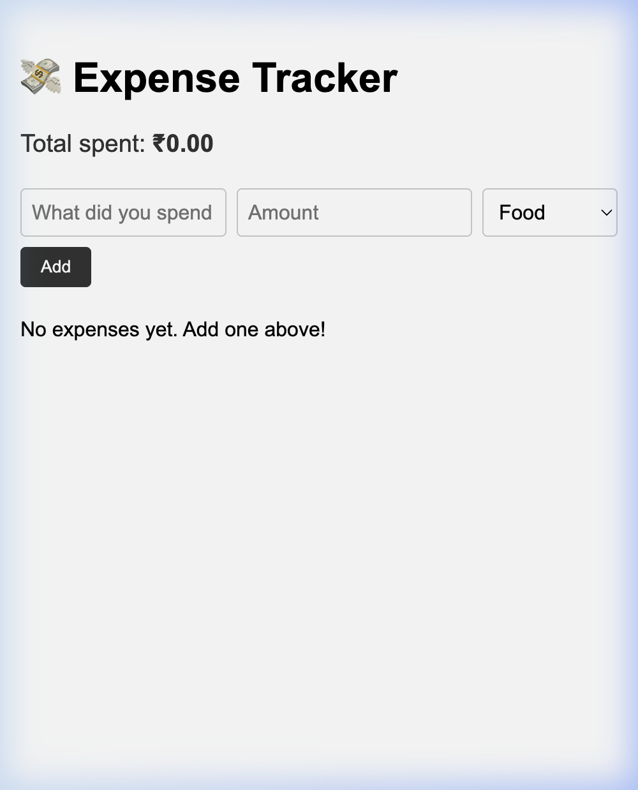
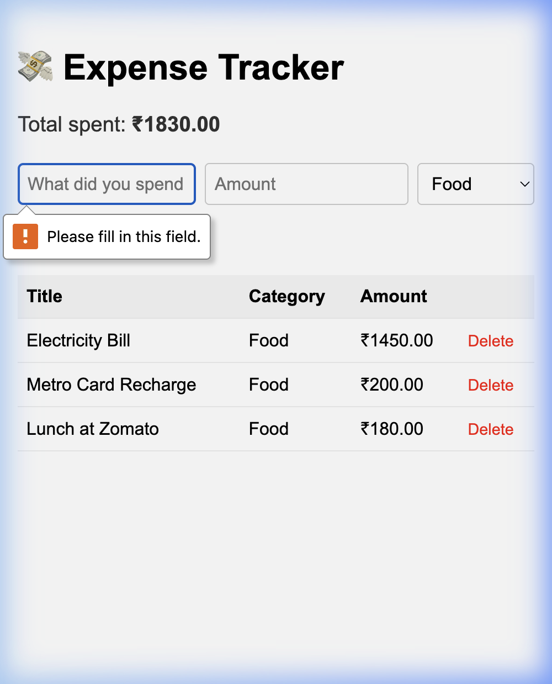

# 💸 Daily Expense Tracker

A super simple daily expense tracker — add what you spent, see your total, delete entries. Built with Python (Flask) + MongoDB.


---

## 📸 Screenshots

**Empty state**


**With expenses logged**


---

## ✨ Features

- ➕ Add an expense — title, amount, and category
- 📋 See all expenses in a clean table
- 💰 Running total at the top
- 🗑️ Delete any entry with one click

---

## 🗂️ Project Structure

```
daily-expense-tracker/
├── app.py               # Flask backend — all routes in ~30 lines
├── requirements.txt     # Dependencies
├── .env                 # MongoDB URI (not committed)
├── templates/
│   └── index.html       # Simple HTML frontend
└── screenshots/         # App screenshots for README
```

---

## 🚀 Setup & Run

**Prerequisites:** Python 3.10+, MongoDB running locally

```bash
# 1. Clone
git clone https://github.com/prithamnandavaram/daily-expense-tracker.git
cd daily-expense-tracker

# 2. Virtual env + install deps
python3 -m venv venv
source venv/bin/activate        # Windows: venv\Scripts\activate
pip install -r requirements.txt

# 3. Create .env
echo "MONGO_URI=mongodb://localhost:27017/expenses_db" > .env

# 4. Run
python app.py
```

Open **http://127.0.0.1:5000** in your browser.

---

## 🔌 API Routes

| Method | Route | Description |
|--------|-------|-------------|
| `GET` | `/` | Show all expenses |
| `POST` | `/add` | Add a new expense |
| `GET` | `/delete/<id>` | Delete an expense |

---

## 📦 Dependencies

```
flask
pymongo
python-dotenv
```
