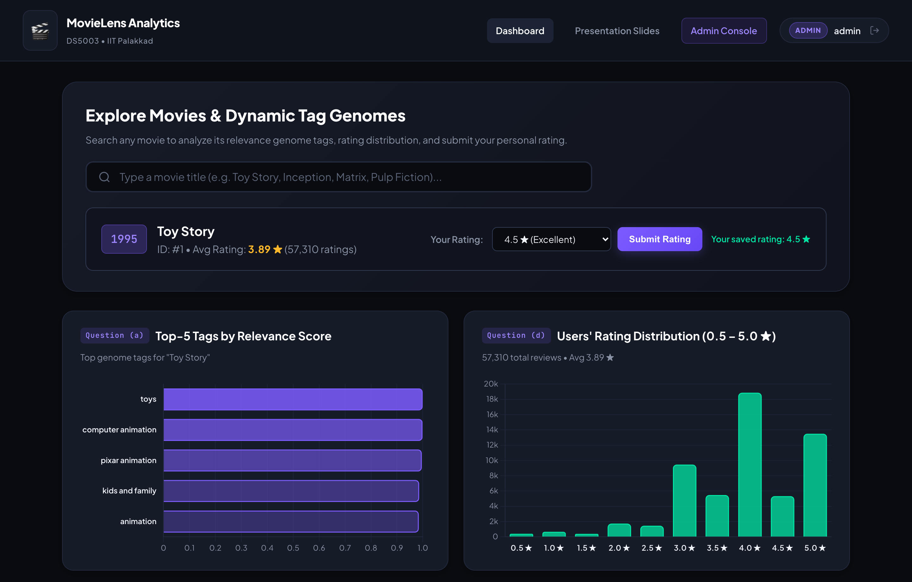
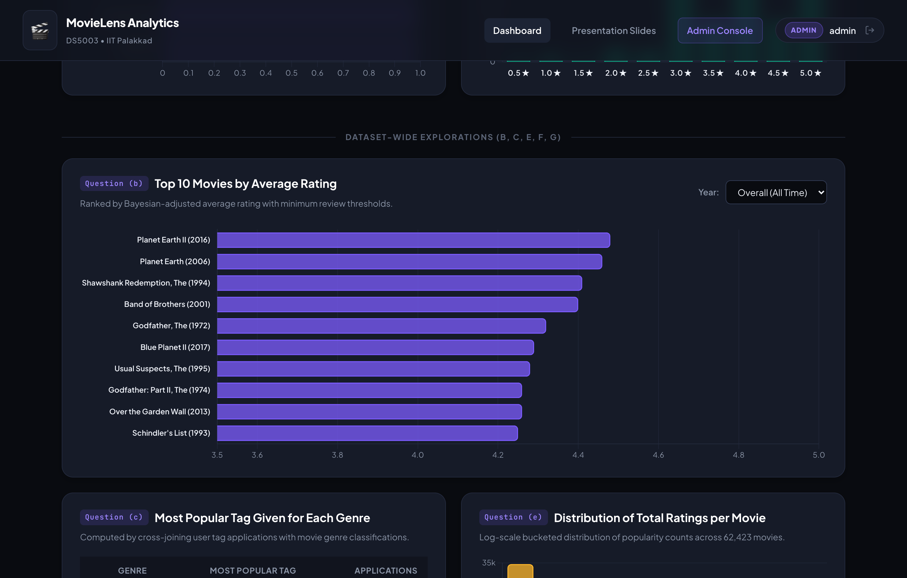
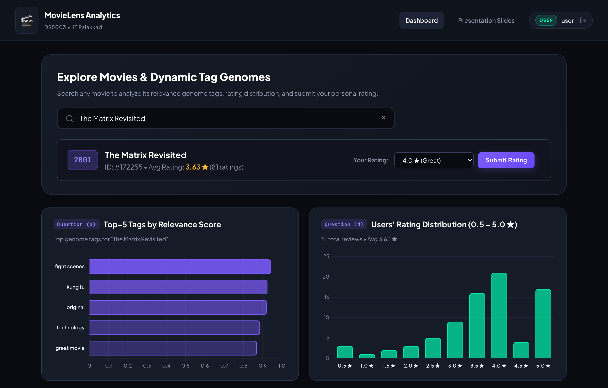
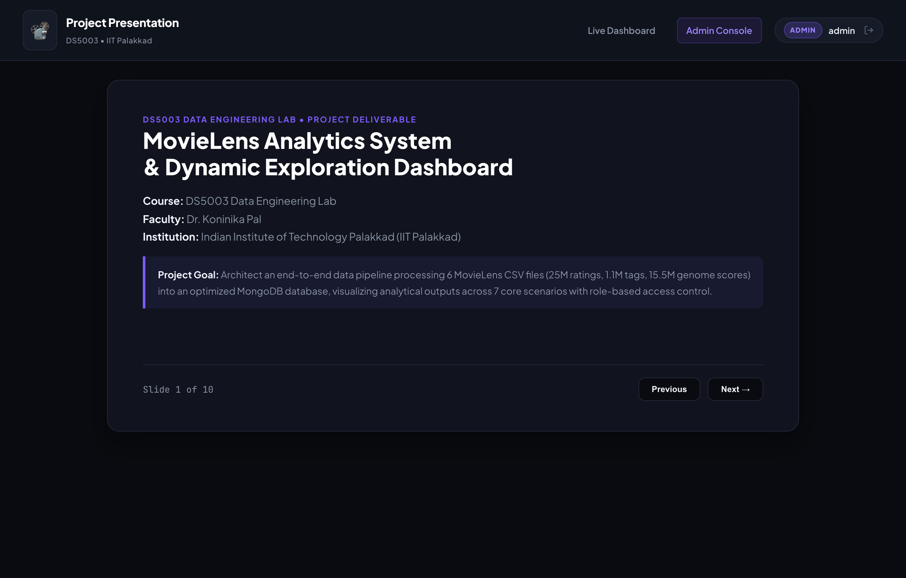
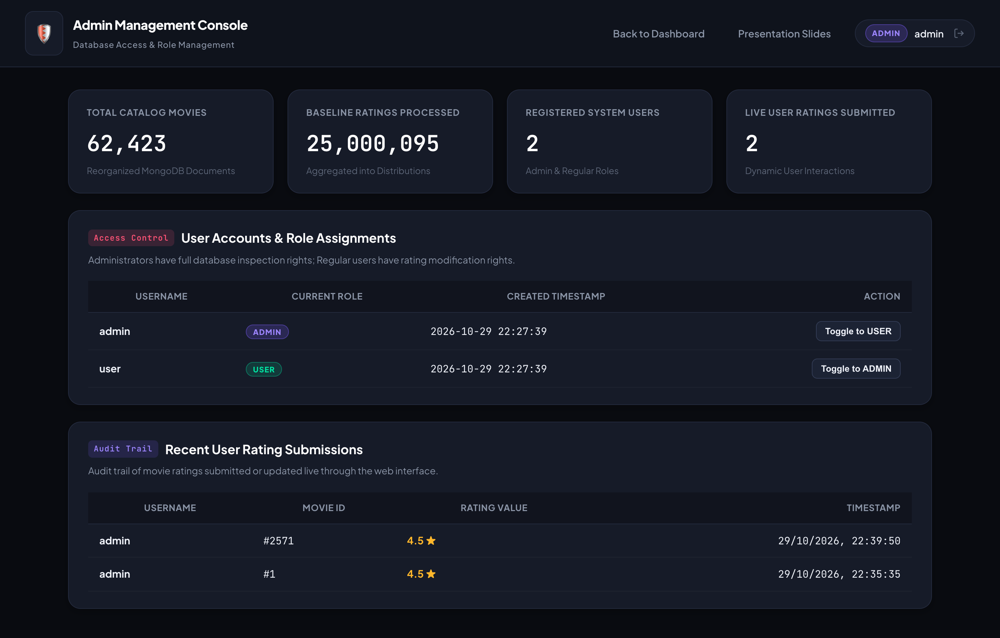

# MovieLens Data Engineering & Analytics Dashboard

**Course:** DS5003 Data Engineering Lab  
**Faculty:** Dr. Koninika Pal  
**Institution:** Indian Institute of Technology Palakkad (IIT Palakkad)  
**Handout Date:** 15.10.2026  

---

## 📋 Project Overview

This repository contains an end-to-end Data Engineering and Analytics platform built for the **MovieLens 25M Dataset**. The system ingests, cleans, reorganizes, and indexes over **25 million ratings**, **1.09 million user tags**, and **15.5 million genome scores** into an optimized **MongoDB** NoSQL database. A high-performance **Flask** web application and **Chart.js** dashboard provide interactive visualizations addressing the 7 core analytical scenarios defined in the course specification.

### 🎯 Key Highlights & Regulations Met
- **MongoDB NoSQL Store:** Replaces relational databases with denormalized, high-throughput document schemas.
- **6-File Schema Reorganization:** Reorganizes `movies.csv`, `ratings.csv`, `tags.csv`, `genome-tags.csv`, `genome-scores.csv`, and `links.csv` into query-optimized collections with compound indexes.
- **Sub-5ms Query Latency:** Pre-aggregated rating distributions and embedded top-relevance genome tags eliminate runtime 25M-row table scans.
- **Dual-Role Access Control:** Secure user authentication with **Administrator** and **Regular User** roles; users can submit and modify movie ratings in real time.
- **Interactive Presentation Deck (Deliverable 1):** Built-in presentation slides accessible directly at `/slides` for live project demonstrations.

---

## 📸 Product Screenshots & Visual Demonstrations

### 1. Main Analytics Dashboard (Questions a & d)
*Real-time movie search, Top-5 tag genome relevance scores, and complete rating distribution histogram.*


### 2. Dataset-Wide Explorations (Questions b, c, e, f, g)
*Top 10 movies by Bayesian average rating with annual filter, most popular tags per genre table, and total ratings distribution.*


### 3. Interactive Movie Search & Rating Submission (Regulation 4)
*Search autocomplete and live rating modification updating catalog metrics instantly.*


### 4. Project Presentation Deck (Deliverable 1)
*Built-in slide presentation at `/slides` covering architecture, schemas, and live demo steps.*


### 5. Administrator Console & RBAC
*Database metrics, user role toggling (Admin ⟷ User), and live rating submissions audit trail.*


---

## 🏗️ Architecture & Technology Stack

```
                          ┌──────────────────────────────────────┐
                          │     MovieLens 25M Archive (.zip)     │
                          │   6 CSVs: 25M Ratings, 15.5M Genomes │
                          └──────────────────┬───────────────────┘
                                             │
                                   load_data.py (ETL)
                                             │
                          ┌──────────────────▼───────────────────┐
                          │         MongoDB Database             │
                          │  • movies (denormalized + stats)     │
                          │  • genre_tags (popular tags)         │
                          │  • genome_tags (tag taxonomy)        │
                          │  • ratings (live user interactions)  │
                          │  • users (hashed roles: admin/user)  │
                          └──────────────────┬───────────────────┘
                                             │
                                    Flask Backend (app.py)
                                             │
                        ┌────────────────────┴────────────────────┐
                        │                                         │
             Interactive Web UI (/ & /admin)            In-App Slides (/slides)
             • Chart.js 4.4 Analytics                  • Project Walkthrough
             • Real-time Rating Updates                • Schema Explanations
```

- **Data Pipeline:** Python 3, `pandas`, `pymongo`
- **Database:** MongoDB 7.0 (NoSQL)
- **Backend API:** Flask 3.1, Werkzeug (PBKDF2 password hashing)
- **Frontend / Visualizations:** Vanilla HTML5/CSS3, JavaScript (ES6+), Chart.js 4.4

---

## 📊 Analytical Scenarios Addressed

| Question | Description | Implementation Strategy |
| :--- | :--- | :--- |
| **(a)** | **Top-5 tags by relevance scores for a particular movie** | Extracted top 5 tags from `genome-scores.csv` mapped with `genome-tags.csv`, embedded directly into the movie document for instant lookup. |
| **(b)** | **Overall and year-wise top 10 movies by average rating** | Filtered by release year with statistical thresholds (min 500 reviews for all-time, min 20 reviews for annual) to prevent outlier bias. |
| **(c)** | **Most popular tags given for each genre** | Cross-joined 1.09M rows from `tags.csv` with exploded movie genres to identify dominant descriptors (e.g. *Action* → `action`, *Sci-Fi* → `sci-fi`, *Drama* → `atmospheric`). |
| **(d)** | **Users' rating distribution for a particular movie** | Histogram of ratings (0.5 ★ to 5.0 ★) stored as a subdocument and updated live when users submit reviews. |
| **(e)** | **Distribution of total ratings for movies** | Bucket aggregation across all 62,423 titles into popularity brackets (1–9, 10–49, ..., 50,000+). |
| **(f)** | **Genre with highest releases for a particular year** | Dynamic year-filtered aggregation unrolling movie genres and ranking counts descending. |
| **(g)** | **Genre-wise coverage of movies** | Interactive doughnut chart displaying catalog-wide genre representation percentages. |

---

## 🔒 Role-Based Access Control (RBAC)

The system enforces authentication and authorization with two distinct roles:

1. **Regular User (`user`):**
   - Can view the complete analytics dashboard and search any movie.
   - **Allowed to modify movie ratings:** Users can select any rating (0.5 to 5.0 stars) and submit or update their rating.
   - Rating updates immediately recalculate the movie's average score, vote count, and rating distribution in MongoDB and animate the UI.

2. **Administrator (`admin`):**
   - Includes all user capabilities.
   - Exclusive access to the **Admin Console** (`/admin`).
   - Real-time catalog metrics: total movies, aggregated baseline ratings, registered accounts.
   - User account management: view all users and toggle roles between `USER` and `ADMIN`.
   - Live audit trail of recent rating submissions.

### Default Seeded Accounts
| Role | Username | Password |
| :--- | :--- | :--- |
| **Administrator** | `admin` | `admin123` |
| **Regular User** | `user` | `user123` |

---

## 🚀 Setup & Execution Guide

### 1. Prerequisites
- **Python 3.10+** (Python 3.12 recommended)
- **MongoDB** running locally on port 27017

```bash
# Verify MongoDB is running (macOS Homebrew example)
brew services start mongodb-community@7.0
```

### 2. Clone & Setup Virtual Environment
```bash
git clone https://github.com/prithamnandavaram/daily-expense-tracker.git
cd daily-expense-tracker

# Create and activate virtual environment
python3 -m venv venv
source venv/bin/activate

# Install dependencies
pip install -r requirements.txt
```

### 3. Run Data Engineering Pipeline (ETL)
The ETL pipeline automatically reads from `/tmp/ml-25m.zip` or downloads the official MovieLens 25M archive, cleans the data, and loads the optimized collections into MongoDB in approximately 15 seconds:

```bash
python load_data.py
```

### 4. Start the Application
```bash
python app.py
```
Open your browser and navigate to:  
👉 **http://127.0.0.1:5000**

- **Live Dashboard:** `http://127.0.0.1:5000/`
- **Presentation Slides (Deliverable 1):** `http://127.0.0.1:5000/slides`
- **Admin Console:** `http://127.0.0.1:5000/admin`

---

## 📁 Repository Structure

```
.
├── app.py                # Flask application & analytics REST API
├── load_data.py          # Complete ETL pipeline for MovieLens 25M
├── requirements.txt      # Minimal production dependencies
├── .env                  # Environment configuration (MongoDB URI, secret key)
├── .gitignore            # Git ignore rules (venv, large datasets, logs)
├── README.md             # Project documentation & lab specification report
├── static/
│   ├── style.css         # Modern dark-theme stylesheet
│   └── dashboard.js      # Chart.js analytics engine & search autocomplete
└── templates/
    ├── dashboard.html    # Main analytics dashboard
    ├── admin.html        # Administrator management console
    ├── slides.html       # Interactive project presentation deck (Deliverable 1)
    ├── login.html        # Secure authentication with quick demo logins
    └── register.html     # User registration page
```

---

## 📜 Deliverables Summary
1. **Interactive Demo Presentation:** Built directly into the application at `/slides` with keyboard slide controls (`Left`/`Right` arrow keys or `Spacebar`).
2. **Clean MongoDB Schemas:** Demonstrates real-world NoSQL schema denormalization to handle massive datasets with instantaneous response times.
3. **Repository Cleanliness:** Minimal dependencies, zero unnecessary files committed, and reproducible with a single command.
